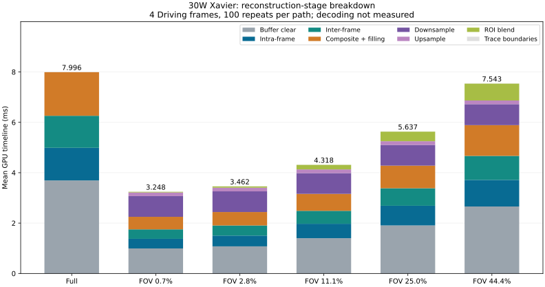

# CUDA C++：按论文阶段拆分耗时

2026-10-29，Jetson AGX Xavier，30W 4CORE（mode 5），未锁频。四组 Driving 各第39帧，960×540，每路径预热10次、计时100次。下文全部是算术平均值，无裁剪。不是完整1068帧测试。

## 论文口径

原论文 Fig.6 / Sec.6.1：Decoding 3.2ms、Intra-frame 1.3ms、Inter-frame 2.5ms、Composite and Filling 2.4ms，总计9.4ms。论文采用15W；这些是论文图中的参考值，不是本次测量，也不与本次30W直接做加速比。

本次输入已经解码，**Decoding 未测**，不能写成0，也不能把论文3.2ms加到本次结果当实测总时间。
Intra-frame 对应视差重投影，Inter-frame 对应光流重投影，Composite and Filling 对应合成与补洞。代码保持光流先于视差的原执行顺序，表格仅按论文栏目排列。

## 重建阶段：GPU timeline 均值（ms）

同一轮的阶段采用CUDA event标记，阶段之间不插入同步。FOV的base和中心ROI两个pass按同类阶段相加。额外列出原论文未单列的清零，以及FOV新增的降采样、上采样和融合。
Full取2.8%配置那一轮的配对基线，并非五轮Full合并后的均值。

| 路径 | Intra-frame | Inter-frame | Composite + Filling | 清零 | 降采样 | 上采样 | ROI融合 | 边界标记 | 重建合计 |
| --- | ---: | ---: | ---: | ---: | ---: | ---: | ---: | ---: | ---: |
| Full | 1.295 | 1.272 | 1.731 | 3.693 | 0.000 | 0.000 | 0.000 | 0.005 | 7.996 |
| FOV 0.7% | 0.383 | 0.374 | 0.498 | 0.994 | 0.822 | 0.146 | 0.026 | 0.005 | 3.248 |
| FOV 2.8% | 0.427 | 0.402 | 0.533 | 1.077 | 0.821 | 0.146 | 0.051 | 0.005 | 3.462 |
| FOV 11.1% | 0.574 | 0.514 | 0.673 | 1.400 | 0.824 | 0.146 | 0.182 | 0.005 | 4.318 |
| FOV 25.0% | 0.782 | 0.694 | 0.898 | 1.907 | 0.823 | 0.146 | 0.382 | 0.005 | 5.637 |
| FOV 44.4% | 1.055 | 0.954 | 1.220 | 2.659 | 0.833 | 0.146 | 0.671 | 0.005 | 7.543 |

清零是当前Full路径最大的单项开销（约46%）。Full到2.8% FOV的重建时间差中，约58%来自清零范围缩小。不能把全部收益归因于视差/光流计算减少。原clearKernel相邻lane沿行方向跨距写入，是值得检查的访存问题；具体硬件瓶颈仍需进一步验证，本次没有优化它。

## 分段标记开销与整体延迟

reference调用原Pipeline.run，仅保留外层计时标记；staged增加内部阶段标记。以下为resident墙钟均值，包含CPU发起及等待GPU完成，不含分配、磁盘、解码或显示。

| 路径 | reference均值(ms) | staged均值(ms) | staged / reference |
| --- | ---: | ---: | ---: |
| Full | 8.016 | 8.019 | 1.000× |
| FOV 0.7% | 3.259 | 3.271 | 1.003× |
| FOV 2.8% | 3.473 | 3.484 | 1.003× |
| FOV 11.1% | 4.329 | 4.340 | 1.003× |
| FOV 25.0% | 5.651 | 5.659 | 1.001× |
| FOV 44.4% | 7.561 | 7.566 | 1.001× |

## CPU/GPU拷贝与解码的区别

上传是CPU缓冲区到CUDA设备缓冲区的拷贝，回传是重建输出回到CPU缓冲区。它们不是网络上传/下载，也不是视频解码。Xavier共享物理DRAM，当前代码仍显式调用cudaMemcpy；本次没有实现零拷贝路径。输入拷贝6,220,800字节，输出1,555,200字节/次。

下表为同一stream reference流水线的event区间均值，区间含对应API调度间隙，不是孤立DMA测量。前三段可相加为GPU timeline总跨度；墙钟另含外层主机开销。

| 路径 | H2D区间(ms) | 重建区间(ms) | D2H区间(ms) | timeline总计(ms) | 墙钟总计(ms) |
| --- | ---: | ---: | ---: | ---: | ---: |
| Full | 1.184 | 8.001 | 0.455 | 9.640 | 9.660 |
| FOV 2.8% | 1.228 | 3.455 | 0.459 | 5.141 | 5.161 |

## 可比性与原始证据

- 原kernel、精度、执行顺序及PSNR代码未改，开启现有fast-resample。分段路径复用同一组kernel。reference仍有外层event开销，不能声称绝对无插桩。
- raw CSV中的wall_total_ms在各stage行重复，只能取stage=total计算均值。h2d_api_wall_ms/d2h_api_wall_ms为诊断字段，后者可能等待前序重建，不能与重建耗时直接相加。
- trace_boundary保留外层与内部event之间的差额，阶段总和已逐样本核对。GPU event跨度可能含CPU发起间隙，不是纯指令执行时间。
- 功耗为30W且样本只有4帧，不能直接与论文15W或此前1068帧均值归因比较。原竞争写入和部分实现差异仍存在；本实验没有验证视觉质量等价。
- 频率日志799个采样点中796个为GPU905.25MHz，其余3个为开始升频阶段；CPU范围1.1904–1.8048GHz。温度CPU36–40°C、GPU33–38°C。频率采样包含预热等时段，不代表每个kernel的逐时频率。
- 全部原始样本和源码快照见[evidence.tar.gz](evidence.tar.gz)中的raw/与source/，本地另保留未压缩raw/。均值见summary.csv，覆盖及加和校验见audit.json。频率/温度记录分别为frequencies.csv和tegrastats.log。源码和二进制哈希另存。没有将解码/网络/显示阶段补成估计值。

