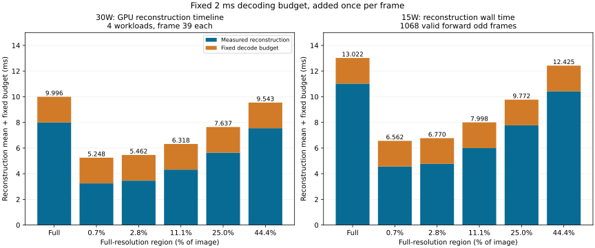

# FOV timing：统一固定2ms解码预算

根据用户指定，所有档位按每帧一次 **2ms** 解码预算计算：`总时间 = 重建实测均值 + 2ms`。
2ms是统一预算假设，不是本次端到端实测，也不是RGB、depth、u、v各加2ms。多路联合解码及格式转换/互操作尚未联调。所有原始时间、质量数据与历史报告保留。

## CUDA C++ 30W：最近分段测试

四组各第39帧，每路径100次，表中重建值为staged GPU timeline均值，与上一轮breakdown一致。未包含额外CPU/GPU拷贝、网络与显示。Full取2.8%配置的配对基线。

| 区域 | 重建均值(ms) | 固定解码预算(ms) | 解码+重建(ms) |
| --- | ---: | ---: | ---: |
| Full | 7.996 | 2.000 | 9.996 |
| 0.7% | 3.248 | 2.000 | 5.248 |
| 2.8% | 3.462 | 2.000 | 5.462 |
| 11.1% | 4.318 | 2.000 | 6.318 |
| 25.0% | 5.637 | 2.000 | 7.637 |
| 44.4% | 7.543 | 2.000 | 9.543 |

## CUDA C++ 15W：完整有效1068帧

表中重建为resident墙钟均值，保留作完整覆盖的历史对照。当前PPT时间已改用上表30W小样本；质量仍来自15W完整1068帧，两组不能视为同一轮联合质量/时间测量。

| 区域 | 重建均值(ms) | 解码+重建(ms) | 含输入输出拷贝再加解码预算(ms) |
| --- | ---: | ---: | ---: |
| Full | 11.022 | 13.022 | 15.161 |
| 0.7% | 4.562 | 6.562 | 8.364 |
| 2.8% | 4.770 | 6.770 | 8.728 |
| 11.1% | 5.998 | 7.998 | 9.839 |
| 25.0% | 7.772 | 9.772 | 11.655 |
| 44.4% | 10.425 | 12.425 | 14.193 |

固定解码预算加入Full与FOV两边，加速比也必须重新计算，不能沿用纯重建的比值。15W的2.8%档为6.770ms，相对同轮Full+decode约1.92×。

[30W原始分段报告](../cu_breakdown_xavier_20261029/README.md)、[15W完整范围报告](../fov_levels_xavier_full_20261027/README.md)、[实测解码实验](../hevc_decode_xavier_20261029/README.md)、[地图解码与精度实验](../map_decode_xavier_20261029/README.md)。
summary.csv同时保留重建原值、预算值、推导总时间及更新后的比值。各档位PSNR没有改变。

