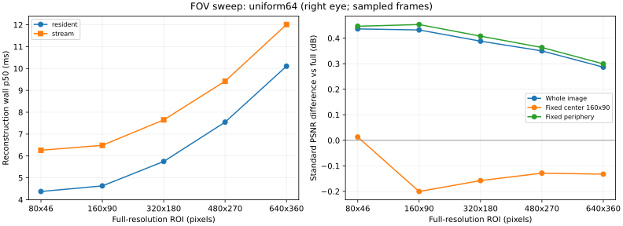

# Xavier FOV quality / latency — 2026-10-27

## 实测范围

- Jetson AGX Xavier，SM 7.2，L4T R35.6.4，CUDA 11.4.315；15W Desktop mode 7，未锁频。测试时查询 GPU 上限为 675.75 MHz。
- 960×540 重建右眼；四组 Driving forward。没有 HEVC 对比，也没有完整双眼/网络/视频解码计时。
- `pilot/` 与 `optimized/`：四组各第 7、39 帧，共 8 帧；五档 ROI × 两种计时 × 三次独立进程运行。每帧每模式预热 10 次、计时 20 次。
- `uniform64/`：每组在可用奇数帧范围内均匀取 16 帧（300 组 7..299，800 组 7..779），总计 64 帧。五档 ROI × 两种计时；每配置一个进程，逐帧预热 10 次、计时 30 次。
- 每次质量来自最后一次计时的实际输出；未把同一质量分数按计时重复次数重复计入均值。64 帧每配置仅一个质量样本，不能据此声称质量置信区间。
- 时间是 pooled wall p50/p95；质量是逐帧 dB 的算术均值。固定中心为 160×90，跨 level 不改变评估区域。

## 64 帧：优化后的各档结果

外围始终为半分辨率重建再上采样，ROI 中心固定。level 是像素大小，不是视角度数。
`Δ` = FOV 对 GT 的分数 − 同次 full 对 GT 的分数；负数为下降。原溢出公式与补充标准公式分别列出，不混用。

| ROI | resident p50 / p95 (ms) | 相对 full 加速 | stream p50 (ms) | 原公式全图 ΔPSNR (dB) | 标准全图 ΔPSNR (dB) | 标准固定中心 ΔPSNR (dB) |
| --- | ---: | ---: | ---: | ---: | ---: | ---: |
| 80x46 | 4.375 / 4.445 | 2.46× | 6.261 | -0.160 | +0.436 | +0.013 |
| 160x90 | 4.630 / 4.701 | 2.32× | 6.485 | -0.152 | +0.432 | -0.200 |
| 320x180 | 5.747 / 5.853 | 1.86× | 7.650 | -0.138 | +0.388 | -0.158 |
| 480x270 | 7.547 / 7.685 | 1.42× | 9.420 | -0.113 | +0.350 | -0.129 |
| 640x360 | 10.106 / 10.290 | 1.06× | 12.012 | -0.082 | +0.287 | -0.133 |

具体 full、half_base、FOV 的绝对质量及外围结果在 [overview.csv](uniform64/overview.csv)，按序列拆分在 [summary.csv](uniform64/summary.csv)。



## 同一批 8 帧：上采样实现优化的贡献

| ROI | 原 FOV resident p50 (ms) | 优化 FOV resident p50 (ms) | 上采样优化带来的整条 FOV 加速 | 优化同次 full p50 (ms) |
| --- | ---: | ---: | ---: | ---: |
| 80x46 | 9.014 | 4.353 | 2.07× | 10.736 |
| 160x90 | 9.286 | 4.627 | 2.01× | 10.735 |
| 320x180 | 10.433 | 5.763 | 1.81× | 10.726 |
| 480x270 | 12.206 | 7.552 | 1.62× | 10.729 |
| 640x360 | 14.766 | 10.107 | 1.46× | 10.733 |

优化开关 `--fast-resample` 重写了 2×双线性上采样：从 FP64 改为 FP32、先计算固定缩放比例，并让线程沿连续像素排列（32×8 block）。本次只能归因于这组上采样改动的组合，未独立测各自收益。

2×比例的坐标/插值权重可精确二进制表示；字节输入的运算也在 FP32 精确范围内。RTX 与 Xavier 的随机字节图像自检均逐字节匹配 FP64 上采样（64×48、960×540、1920×1080）。没有改变视差/光流几何精度，也没有 Graph、跨帧重建缓存或预计算底图。原 PSNR 溢出公式未改。

这是对当前 CUDA full 基线的比较，不代表与最优实现的 full 重建相比也有相同收益。优化前后实验顺序为先原版、再优化版；未锁频，不能把微小差值解释成严格因果效果。

## 质量解释与限制

- 标准 PSNR 在评估脚本中另算（float64 差分、峰值 255）；旧版 `legacy_whole_psnr_db` 保留，不能混用。
- 全图 PSNR 提高不等于感知质量提高；平滑、原重建误差及竞争写入都会影响分数。没有运行 SSIM/LPIPS，也没有主观评价。
- 8 帧原版扫描中，同一帧/同一档 resident 的三次固定中心 ΔPSNR，范围中位数约 0.225 dB、最大约 2.201 dB。这是实际重复运行波动，不能当作质量置信区间；小于该量级的差异尤其不宜下稳定结论。
- 更大的 ROI 不保证当前实现的质量单调改善。原始 uint8 深度缓存和无原子保护的竞争写入仍保留，ROI 的线程布局/边界变化可能改变遮挡像素的胜出者。**不能宣称注视区质量与 full 相同。**
- 只证明上采样模块逐字节一致；不保证完整真实图像逐像素一致，也没有把完整图像的随机差异归因于 FP32。
- resident 不含输入上传/输出回传；stream wall 含这些传输。两者都排除文件读取、分配、质量计算和图像保存。GPU timeline 只包围重建 kernel。
- 后续选 level 需要指定中心区域质量容忍度；不能仅凭全图均值自动选最小 ROI。

## 原始证据与复现

每个目录内 `metadata.json` 保存程序/输入/runner 哈希与环境；`evidence.tar.gz` 包含原始计时 CSV、逐帧质量、日志、温度记录、自检和当次源码快照（runner SHA-256 已核对）。未压缩原件仍保存在本地与板上实验目录。

板上目录：`/home/yingtian/stereo-fov-20261027/`。原版源码在 `src/`，优化版在 `fast_src/`；两个二进制分别为 `pirate_bench` 和 `pirate_bench_fast`。原版 CUDA 源码对应仓库提交 `0e68575`。

编译器通过 NVIDIA 源的 `cuda-nvcc-11-4`、`cuda-cudart-dev-11-4`、`cuda-cccl-11-4` 包解压到实验目录的 `toolchain/root/`，没有改变系统 CUDA 安装。编译参数：`-O3 -std=c++14 --fmad=false -arch=sm_72`。

```bash
python3 jetson_cuda/evaluate_levels.py --binary ./build/pirate_bench \
  --manifest /path/to/fov_uniform16/manifest.txt --out results/xavier/new_levels \
  --repeats 30 --quality-runs 1 --timing both --fast-resample --batch-frames
# 主机汇总/画图（画图额外需要 matplotlib）：
python3 jetson_cuda/report_levels.py results/xavier/new_levels --plot
```
