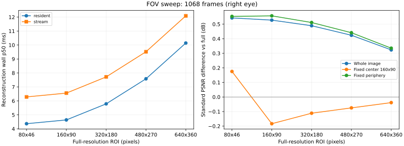

# 完整有效 Driving：Xavier FOV 质量与时间

日期：2026-10-27。Jetson AGX Xavier，15W Desktop mode 7，L4T R35.6.4，CUDA 11.4.315。未锁频。

## 覆盖范围与口径

这次覆盖当前代码四组 Driving forward 的全部有效右眼重建帧，共 **1068 帧**，不是抽样：

| 序列 | 帧数 | 帧 ID |
| --- | ---: | --- |
| 15 mm / 300 | 147 | 7–299 的全部奇数帧 |
| 15 mm / 800 | 387 | 7–779 的全部奇数帧 |
| 35 mm / 300 | 147 | 7–299 的全部奇数帧 |
| 35 mm / 800 | 387 | 7–779 的全部奇数帧 |

不包含 backward 场景、偶数帧交替重建，或原 800 帧脚本范围之外的 781–799。不能称为整个原始 Driving 数据集所有场景/所有帧的完整评估。

- 五档中心 ROI，外围固定为半分辨率重建；`--fast-resample` 开启。
- 每档每帧均执行 full / half_base / fov；resident / stream 各一轮；每帧预热 3 次、计时 5 次。
- 每档每模式每种计时有 5340 个计时样本；质量取最后一次计时的实际输出，每帧每配置一个样本。
- 32 帧一批，档位顺序按批次轮换，三种模式顺序按计时迭代轮换。输入和源码 SHA-256 已核验。
- 计时与质量计算、文件 I/O、分配分开；stream wall 另含输入上传和输出回传。没有网络/视频解码/显示计时。
- 使用与 64 帧实验相同的 CUDA 二进制；只修改 Python 分批与增量保存逻辑。两轮预热/重复次数不同。
- 总表按所有帧汇总，因此 800 帧组权重更大；旧 64 帧表每组等量抽样。跨轮不能忽略样本权重变化。

## 主结果

PSNR 差 = FOV 对 GT 的分数 − 同次 full 对 GT 的分数；负数代表下降。原公式保留 uint8 溢出行为。
双眼平均差是**推导值**：仅在左眼不变、按左右眼 dB 取平均时，等于右眼差的一半；不是另跑完整双眼所得，也不是耗时减半。

| ROI | resident p50 / p95 (ms) | 相对 full 加速 | stream p50 (ms) | 右眼 ΔPSNR，原公式 (dB) | 推导双眼平均 ΔPSNR (dB) |
| --- | ---: | ---: | ---: | ---: | ---: |
| 80x46 | 4.367 / 4.782 | 2.46× | 6.285 | -0.1727 | -0.0864 |
| 160x90 | 4.637 / 5.016 | 2.32× | 6.557 | -0.1668 | -0.0834 |
| 320x180 | 5.788 / 6.220 | 1.86× | 7.717 | -0.1462 | -0.0731 |
| 480x270 | 7.582 / 8.009 | 1.42× | 9.519 | -0.1200 | -0.0600 |
| 640x360 | 10.142 / 10.633 | 1.06× | 12.090 | -0.0861 | -0.0430 |

完整 full / half_base / fov 的绝对分数、p99 和 GPU 时间见 [overview.csv](overview.csv)。各序列结果见 [summary.csv](summary.csv)。

## 四组分别看原公式的右眼质量差

| 序列 | 80×46 | 160×90 | 320×180 | 480×270 | 640×360 |
| --- | ---: | ---: | ---: | ---: | ---: |
| driving_15_300 | -0.1410 | -0.1358 | -0.1218 | -0.1024 | -0.0774 |
| driving_15_800 | -0.2252 | -0.2179 | -0.1962 | -0.1680 | -0.1258 |
| driving_35_300 | -0.1691 | -0.1633 | -0.1385 | -0.1078 | -0.0715 |
| driving_35_800 | -0.1338 | -0.1287 | -0.1083 | -0.0834 | -0.0551 |

## 补充标准 PSNR（与原公式分开）

标准指标采用 float64 差分、峰值 255，未修改原 PSNR。固定中心始终为 160×90；外围为其补集。

| ROI | 全图 ΔPSNR (dB) | 固定中心 ΔPSNR (dB) | 固定外围 ΔPSNR (dB) |
| --- | ---: | ---: | ---: |
| 80x46 | +0.5429 | +0.1752 | +0.5533 |
| 160x90 | +0.5276 | -0.1834 | +0.5571 |
| 320x180 | +0.4892 | -0.1114 | +0.5112 |
| 480x270 | +0.4237 | -0.0748 | +0.4411 |
| 640x360 | +0.3234 | -0.0387 | +0.3351 |



## 解释边界

- 仍保留原 uint8 深度缓存及非原子竞争写入；当前结果不能保证逐像素复现，也不能保证 ROI 质量与 full 一致。扩大帧覆盖不会修复该问题。
- 每帧每配置仅一个质量输出，重复计时不是独立质量样本。均值/百分位数不是置信区间。
- PSNR 上升不等于主观质量提高；没有测 SSIM/LPIPS。原公式与标准公式的趋势可能不同。
- 加速针对当前 CUDA full 路径，包含之前的上采样实现优化；不能全部归因于缩小 FOV，也不代表与最优 full 实现相比的收益。
- 旧 [64 帧报告](../fov_levels_xavier_20261027/README.md) 和原始记录保留，没有覆盖。

## 原始证据与重跑

`evidence.tar.gz` 包含逐次时间、逐帧质量、原始 CSV/日志、输入/程序哈希、温度日志和源码快照；未压缩副本仍保存在本地和板上。
板上实验目录：`/home/yingtian/stereo-fov-full-20261027/`；输入目录为其中 `fov_full1068/`。
同一板上的二进制：`/home/yingtian/stereo-fov-20261027/pirate_bench_fast`。

```bash
python3 jetson_cuda/evaluate_levels.py \
  --binary /home/yingtian/stereo-fov-20261027/pirate_bench_fast \
  --manifest /home/yingtian/stereo-fov-full-20261027/fov_full1068/manifest.txt \
  --out results/xavier/full1068_new --batch-size 32 --warmup 3 --repeats 5 \
  --quality-runs 1 --timing both --fast-resample
python3 jetson_cuda/report_levels.py results/xavier/full1068_new --plot
```
