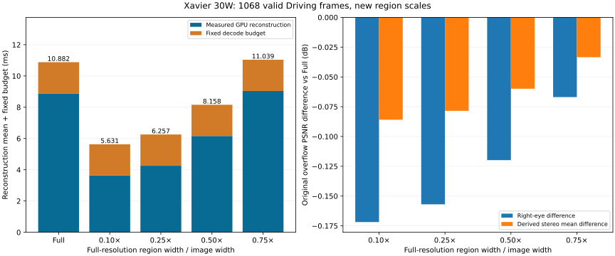

# 新缩放档位：完整有效 Driving 质量与时间

2026-10-29，Jetson AGX Xavier，30W 4CORE，未锁频。CUDA C++、fast-resample开启。新档位为中心区域宽高相对全图的线性比例，不是面积比例，也不改变ROI内的全分辨率采样。

| 线性比例 | 中心区域尺寸 | 占全图面积 |
| --- | --- | ---: |
| 0.10× | 96×54 | 1.00% |
| 0.25× | 240×135 | 6.25% |
| 0.50× | 480×270 | 25.00% |
| 0.75× | 720×405 | 56.25% |

## 覆盖与计时口径

完整覆盖现有代码四组Driving forward的1068个有效右眼重建帧：15mm/300与35mm/300各147帧（7–299全部奇数帧），15mm/800与35mm/800各387帧（7–779全部奇数帧）。不包含backward、偶数帧交替重建及原脚本范围外的尾帧。

各帧各档full/half_base/fov均重新执行；预热3次、计时5次，质量取最后一次计时的实际输出，每帧每配置一个质量样本。每档每模式有1068个质量输出和5340个计时样本。32帧一批，档位及模式顺序轮换。质量和时间来自本轮同一数据覆盖与功耗模式。

时间只报告算术平均值。GPU timeline包含降采样、重建、上采样、融合及相关launch间隙，墙钟另列；均不含输入输出拷贝、分配、文件I/O、质量计算、网络、解码或显示。每帧统一增加一次固定2ms解码预算，属于推导预算，不是多路联合解码或端到端实测。

本轮图像保存改为批量写入相同RGB字节，发生在重建计时区间之外；重建kernel、精度和PSNR公式没有因此改变。使用独立输出目录，旧结果保留。

## 新档位主结果

PSNR差为FOV对GT的分数减去同档同帧Full对GT的分数。原uint8溢出PSNR保留。双眼差是推导值：仅当左眼不变、按左右眼PSNR的dB取平均时，等于右眼差的一半；时间不除以2。

| 区域比例 | GPU重建均值(ms) | 加固定解码预算(ms) | 对配对Full+decode加速 | 右眼ΔPSNR(dB) | 推导双眼平均ΔPSNR(dB) |
| --- | ---: | ---: | ---: | ---: | ---: |
| 0.10× | 3.631 | 5.631 | 1.93× | -0.1718 | -0.0859 |
| 0.25× | 4.257 | 6.257 | 1.74× | -0.1569 | -0.0785 |
| 0.50× | 6.158 | 8.158 | 1.32× | -0.1198 | -0.0599 |
| 0.75× | 9.039 | 11.039 | 0.95× | -0.0669 | -0.0335 |

单一Full参考（0.25×测试轮）GPU重建均值为8.882ms，加固定解码预算后为10.882ms。各行加速比使用各自同档的配对Full，而不是全部统一使用这一参考。

## 补充标准PSNR与墙钟均值

标准PSNR单独采用float64差分、峰值255；固定中心始终160×90，外围为补集。没有修改原PSNR公式。

| 比例 | 重建墙钟均值(ms) | 标准全图ΔPSNR(dB) | 标准固定中心ΔPSNR(dB) | 标准固定外围ΔPSNR(dB) |
| --- | ---: | ---: | ---: | ---: |
| 0.10× | 3.653 | +0.5433 | +0.1216 | +0.5567 |
| 0.25× | 4.280 | +0.5139 | -0.1841 | +0.5409 |
| 0.50× | 6.181 | +0.4246 | -0.0870 | +0.4428 |
| 0.75× | 9.063 | +0.2589 | -0.0400 | +0.2683 |

## 解释边界与证据

- 当前仍是固定中心FOV档位测试，动态deadline选择、眼动追踪和jitter下deadline-miss改善尚未验证。
- 原uint8深度缓存及非原子竞争写入仍保留；单次输出不能证明逐像素可复现或质量稳定。重复计时不是独立质量样本；均值不是置信区间。
- Full包含现有完整scratch清零；缩小区域也减少清零工作。加速不能全部归因于重投影计算，未与最优Full实现比较。
- 本轮是实际新档位数据，不是把旧档位标签替换。旧30W四帧和15W完整实验保留，不能混为本轮采样。
- overview.csv保留每档full/half_base/fov的全部均值与标准区域指标。scale_results.json是PPT/图表的数据接口；audit.json记录精确覆盖校验。逐帧quality.csv和逐次timings.csv为原始证据，若Git上使用压缩归档，见同目录evidence.tar.gz。
- 元数据保存输入/程序SHA；若source/快照目录存在，报告脚本会验证runner与CUDA源码SHA。没有source/时audit不会声称已验证源码。
- 标准局部PSNR若MSE为0，保留合法正无穷，不裁剪帧。JSON将无穷写为字符串inf/-inf；若差值平均同时包含正负无穷，记为null并在报告中注明未定义，不填替代数值。主PSNR原公式全图分数与时间要求有限。

